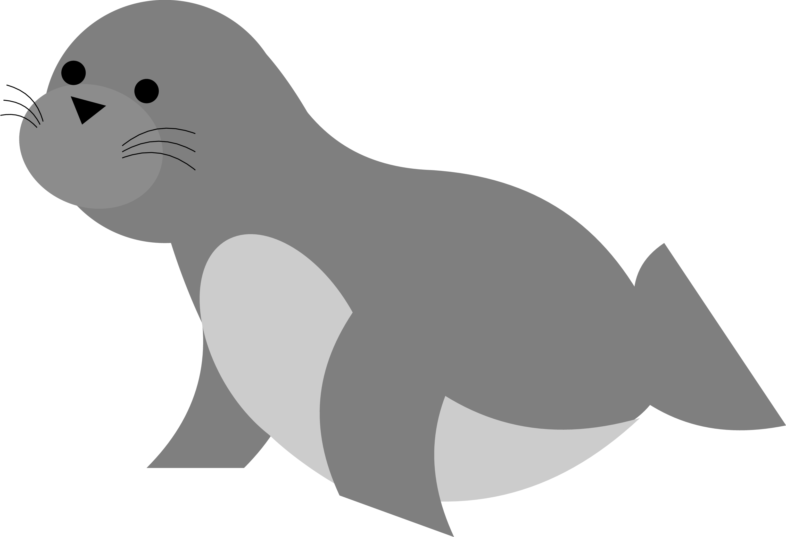

[](https://pypi.org/project/sealwatch/)
[](https://github.com/uibk-uncover/sealwatch/actions/workflows/on_commit.yml)
[](https://sealwatch.readthedocs.io/)
[](https://pypi.org/project/sealwatch/)
[](https://github.com/uibk-uncover/sealwatch/blob/main/LICENSE)



# sealwatch

Modern steganalysis in Python.

**sealwatch** is a Python package implementing modern image steganalysis algorithms,
for JPEG and spatial images.

- **Analytical attacks**: chi2, SPA, WS, the F5 histogram attack, and RJCA.
- **Handcrafted features**: from SPAM to the rich models, with the FLD ensemble as detector,
  matching the Matlab reference implementations of the DDE Lab, Binghamton University.
- **Neural networks**: XuNet, SRNet, Zhu-Net, UcNet, EfficientNet and PENet,
    with pretrained weights.
- **Fast**: Rust backends for SPAM, SRM, CRM, DCTR and GFR.

Documentation: https://sealwatch.readthedocs.io


## Installation

```bash
pip install sealwatch
```

Prebuilt wheels contain the Rust backend.
Building from source, e.g., on other platforms or from a clone of the repository,
requires the [Rust toolchain](https://rustup.rs/).


## Quick start

Spatial steganalysis, with the WS attack:

```python
import numpy as np
from PIL import Image
import sealwatch as sw

# load suspicious image
x1 = np.array(Image.open("suspicious.png"))

# estimate change rate of LSB replacement
beta_hat = sw.ws.attack(x1)
```

JPEG steganalysis, with [jpeglib](https://jpeglib.readthedocs.io/) to access the DCT coefficients:

```python
import jpeglib
import sealwatch as sw

# load suspicious image
jpeg1 = jpeglib.read_dct("suspicious.jpeg")

# extract cc-JRM features, for a trained detector
features = sw.ccjrm.extract(y1=jpeg1.Y, qt=jpeg1.qt[0])
features = sw.tools.features.flatten(features)
```

How to train a detector is in the [user guide](https://sealwatch.readthedocs.io/en/latest/guide/index.html).


## Methods

| Method | Type | Domain | Paper |
| --- | --- | --- | --- |
| chi2: chi-square attack | attack | spatial | [link](https://doi.org/10.1007/10719724_5) |
| SPA: sample pair analysis | attack | spatial | [link](https://doi.org/10.1109/ICIP.2002.1039052) |
| WS: weighted stego-image | attack | spatial | [link](https://doi.org/10.1117/12.521350), [link](https://doi.org/10.1117/12.766820) |
| F5 histogram attack | attack | JPEG | [link](https://doi.org/10.1007/3-540-36415-3_20) |
| RJCA: reverse JPEG compatibility attack | attack | JPEG | [link](https://doi.org/10.1109/TIFS.2019.2940904) |
| HCF-COM: center of mass of the histogram characteristic function | features | spatial | [link](https://doi.org/10.1117/12.476813) |
| SPAM: subtractive pixel adjacency matrix (686) | features | spatial | [link](https://doi.org/10.1109/TIFS.2010.2045842) |
| SRM: spatial rich model (34671) | features | spatial | [link](https://doi.org/10.1109/TIFS.2012.2190402) |
| SRMQ1: SRM with quantization 1 (12753) | features | spatial | [link](https://doi.org/10.1109/TIFS.2012.2190402) |
| CRM: color rich model (5404) | features | spatial | [link](https://doi.org/10.1109/WIFS.2014.7084325) |
| JRM: JPEG rich model (11255) | features | JPEG | [link](https://doi.org/10.1117/12.907495) |
| cc-JRM: cartesian-calibrated JRM (22510) | features | JPEG | [link](https://doi.org/10.1117/12.907495) |
| DCTR: discrete cosine transform residual (8000) | features | JPEG | [link](https://doi.org/10.1109/TIFS.2014.2364918) |
| PHARM: phase-aware projection rich model (12600) | features | JPEG | [link](https://doi.org/10.1117/12.2075239) |
| GFR: Gabor filter residual (17000) | features | JPEG | [link](https://dl.acm.org/doi/10.1145/2756601.2756608) |
| FLD ensemble | detector | | [link](https://doi.org/10.1109/TIFS.2011.2175919) |
| XuNet | neural network | spatial | [link](https://doi.org/10.1109/LSP.2016.2548421) |
| SRNet | neural network | spatial, JPEG | [link](https://doi.org/10.1109/TIFS.2018.2871749) |
| Zhu-Net | neural network | spatial | [link](https://doi.org/10.1109/TIFS.2019.2936913) |
| UcNet | neural network | color | [link](https://doi.org/10.1109/TIFS.2022.3196265) |
| EfficientNet | neural network | JPEG | [link](https://proceedings.mlr.press/v97/tan19a.html) |
| PENet | neural network | color | [link](https://doi.org/10.1109/TIFS.2024.3486027) |

<!-- TODO: add RS steganalysis, not implemented yet:
J. Fridrich, M. Goljan, R. Du.
Reliable detection of LSB steganography in color and grayscale images.
ACM Workshop on Multimedia and Security, 2001.
https://doi.org/10.1145/1232454.1232466 -->

The number in brackets is the dimensionality of the features.


## Scope

sealwatch detects steganography, for research in steganalysis.
To generate stego images, see our sister project [conseal](https://github.com/uibk-uncover/conseal).


## Contributing

Contributions are welcome.
Please report bugs and deviations from reference implementations as [GitHub issues](https://github.com/uibk-uncover/sealwatch/issues).


## Acknowledgements

Developed by [Martin Beneš](https://github.com/martinbenes1996) and [Benedikt Lorch](https://github.com/btlorch/), University of Innsbruck.

The feature extractors and the FLD ensemble match the reference author's implementations.
However, it is the user's responsibility to verify this.
For the differences, see [compatibility.md](compatibility.md).

sealwatch is released under the [Mozilla Public License 2.0](https://github.com/uibk-uncover/sealwatch/blob/main/LICENSE).
