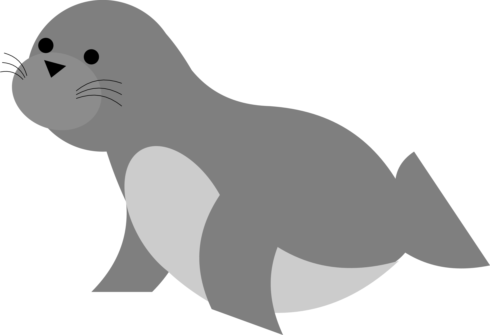

:html_theme.sidebar_secondary.remove:

.. rst-class:: hero-title

sealwatch
=========

.. rst-class:: hero-tagline

Modern steganalysis in Python.

**sealwatch** is a Python package implementing modern image steganalysis algorithms,
for JPEG and spatial images.

.. code-block:: console

   $ pip3 install sealwatch

.. grid:: 1 2 2 2
   :gutter: 3
   :margin: 4 4 0 0

   .. grid-item-card:: User guide
      :link: guide/index
      :link-type: doc

      Load a suspicious image and train a detector.

   .. grid-item-card:: Reference
      :link: reference
      :link-type: doc

      Every attack, feature set and detector, with parameters.

   .. grid-item-card:: Glossary
      :link: glossary
      :link-type: doc

      Short definitions of the terms.

   .. grid-item-card:: FAQ
      :link: faq
      :link-type: doc

      Contributing and common questions.

Quick start
-----------

.. tab-set::

   .. tab-item:: Spatial

      .. code-block:: python

         import numpy as np
         from PIL import Image
         import sealwatch as sw

         # load suspicious image
         x1 = np.array(Image.open("suspicious.png"))

         # apply WS steganalysis
         beta_hat = sw.ws.attack(x1)  # estimate change rate
         print(beta_hat > 0.)

   .. tab-item:: JPEG

      .. code-block:: python

         import jpeglib
         import pickle
         import sealwatch as sw

         # load suspicious image
         jpeg1 = jpeglib.read_dct("suspicious.jpeg")

         # extract cc-JRM features
         features = sw.ccjrm.extract(y1=jpeg1.Y, qt=jpeg1.qt[0])
         features = sw.tools.features.flatten(features)

         # predict cover/stego label with a trained detector
         model = pickle.load(open("model.pickle", "rb"))
         y_hat = model.predict(features[None])

Methods
-------

.. list-table::
   :class: method-table
   :widths: 25 75
   :header-rows: 1

   * - Type
     - Methods
   * - Analytical attacks
     - chi2, F5, SPA, WS, RJCA
   * - Features
     - CRM, cc-JRM, HCF-COM, JRM, DCTR, PHARM, GFR, SPAM, SRM
   * - Detectors
     - ensemble of FLD
   * - Neural networks
     - XuNet, SRNet, ZhuNet, UcNet, EfficientNet, PENet

Related projects
----------------

.. grid:: 1 2 2 2
   :gutter: 3

   .. grid-item-card:: jpeglib
      :link: https://jpeglib.readthedocs.io/

      Read and write the DCT coefficients of JPEG images,
      used by sealwatch for JPEG steganalysis.

   .. grid-item-card:: conseal
      :link: https://conseal.readthedocs.io/

      Steganographic embedding simulators,
      to generate the stego images detected by sealwatch.

.. toctree::
   :hidden:
   :maxdepth: 2

   guide/index
   reference
   glossary
   faq
